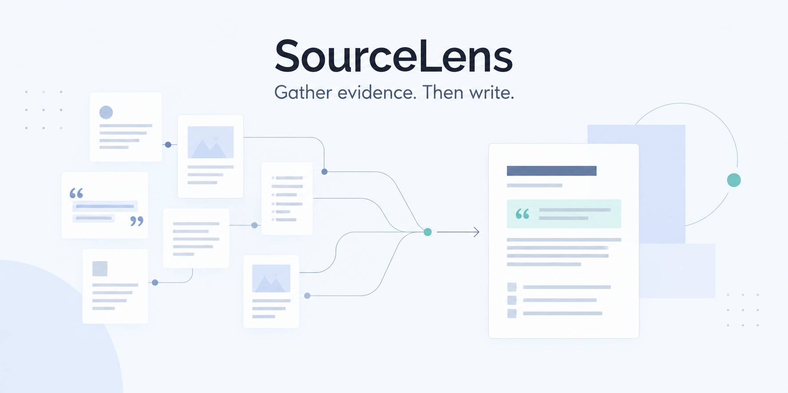
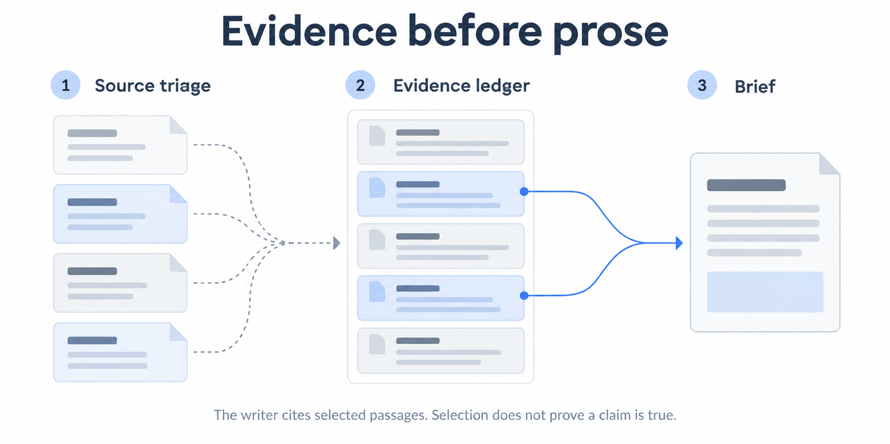

# SourceLens

> **Website-upload edition:** The runnable code, tests, prompts, selected report and narrated demo are visible here. All other recorded runs and the original complete manifest are preserved inside [complete-release.zip](complete-release.zip). Extract that archive into a separate folder to inspect the full experiment history and follow historical run links. This smaller edition includes only the selected run in its `runs/` directory.



SourceLens organizes evidence before writing a company brief. The reader can move from a sentence to its selected passages, inspect source decisions, and see what information the writer was allowed to use.

| Start with | Open |
|---|---|
| The output | [Saved research brief](submission/brief.md) |
| The design changes | [Three original experiments](TEST_LOG.md) |
| The actual API outcomes | [Live test results](LIVE_TEST_RESULTS.txt) |

> **Current status:** Saved examples and the local UI work without a key. The latest Groq GPT-OSS-20B v4 run is **failed** (`ui-20261006T174251Z-b67d76`). Do not treat this as a proven final live route. Earlier free OpenRouter runs completed on older revisions but had content issues. This account then exhausted its daily free allowance. No paid OpenRouter calls were used.

## Three minutes to inspect an example

1. Extract the complete ZIP and install **Python 3.10+** if needed.
2. Open a terminal inside the extracted folder and run `python3 webui.py`. On Windows, run `py webui.py`.
3. Visit **http://127.0.0.1:8767/** and choose **03-precision**.

No API key or Python dependency installation is needed for that walkthrough. The 511-word example is an original captured model-session run. Opening it does not generate a new report. The supplied case is fictional **SRVCABLE**, researched as of **23 September 2026** using eight documents.

Read the brief, inspect its evidence and source decisions, then download the exact Markdown. Select an output only after reading the underlying evidence yourself.

## Evidence before prose



*AI-generated conceptual illustrations of the v4 design, not app screenshots or proof of a completed run.*

**First, triage the sources.** Relevant primary documents remain usable. Older or conflicting secondary material is context. Irrelevant entities and promotional instructions are excluded.

**Then, collect the evidence.** The ledger records model-selected claims and passage IDs. Code attaches the original text, preserving quotation provenance.

**Finally, write within that selection.** The v4 writer can cite only passages chosen by the ledger. That restriction makes the evidence selection inspectable, but it also creates a limitation: a useful fact missed by the ledger can be absent from the brief. There is no separate semantic audit stage in SourceLens.

The output contains Snapshot, Bull case, Bear case, Open questions and Sources. Citation presence does not prove correct interpretation, correct denominators or complete coverage.

## Two ways to use the project

| Mode | Requirements | What it demonstrates |
|---|---|---|
| Inspect saved examples | Python and a browser | Preserved model-session outputs, evidence and source decisions |
| Attempt fresh v4 generation | Python, dated documents and a provider API key | Experimental source triage → evidence → writer workflow; final code not end-to-end verified |

For fresh generation, open **Generate a new report**, select **v4 / Groq**, enter model **`openai/gpt-oss-20b`**, and use your own **Groq API key**. Allow roughly 5–10 minutes. See the actual outcome above and [run results](LIVE_TEST_RESULTS.txt); another run can differ or fail. OpenRouter is a separate service with a separate key, and its free routes are not recommended for a deadline demonstration.

The key is used by the local server and is not written to run artifacts or browser storage. The selected documents are sent to the chosen provider. Never include `.env` in a shared repository. See [provider setup](PROVIDER_SETUP.md) and [engine notes](ENGINE_NOTES.md) for configuration and commands.

A ticker does not fetch company documents or market prices. Supply dated `.md` or `.txt` files; PDFs are unsupported. Uploading a pack replaces the included documents for that run.

## Reproducibility and contribution

The three original v1–v3 experiments and their captured responses remain unchanged. They are model-session handoffs, not authenticated API performance measurements. [LEGACY_README.md](LEGACY_README.md) documents that original TypeScript CLI, which requires **Node 22.18+**. The UI and experimental v4 engine use Python.

SourceLens shares its new v4 passage engine, provider handling and UI with BriefCheck. Its distinct design is the evidence-ledger restriction before writing. State the assistance received and your own contribution accurately; different visual styles do not imply independent authorship.

Checks cover response structure, passage IDs and selected consistency rules. They do not establish source authenticity or factual truth. Older completed live runs are retained as development evidence, with their content problems disclosed in [LIVE_TEST_RESULTS.txt](LIVE_TEST_RESULTS.txt).

## Prepare your demonstration

Follow [START_HERE.txt](START_HERE.txt), then [RECORDING_GUIDE.md](RECORDING_GUIDE.md). Review the prepared narrated walkthrough, or make your own 2–3 minute explanation. The supplied video identifies the saved example, shows source decisions, and discloses the failed final live attempt. Use [SUBMISSION_CHECKLIST.md](SUBMISSION_CHECKLIST.md) for the required links and artifacts. No upload or submission has been performed for you.

Local checks:

```bash
python3 -m unittest test_v4 test_webui -q
node --test tests/*.test.ts
node src/cli.ts replay --run runs/03-precision
```

The Node commands check the original implementation; the UI itself does not need Node. Tests and replay make no model calls. See [RELEASE_CHECKS.txt](RELEASE_CHECKS.txt) for the recorded results.


[Watch the narrated demo](submission/demo.mp4) · [Read its transcript](submission/demo-narration.txt). Edited real app screens with Kokoro synthetic narration; review before submission.
